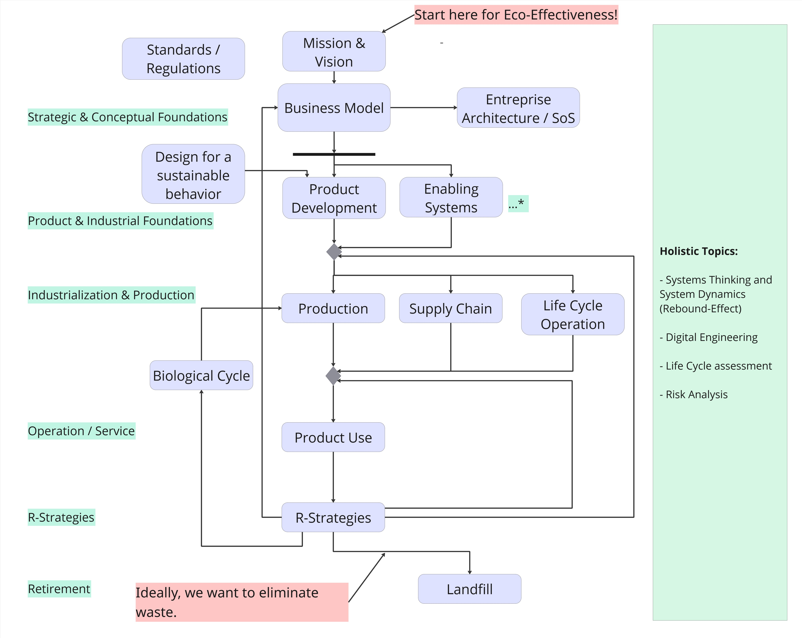

# The Sustainability Virtual Lab

**We develop, test and publish practices that make engineered systems sustainable,
and we help industry to use them.**

The Lab is an open community of systems engineers, sustainability experts and
researchers. It grew out of the INCOSE Sustainability Working Group, the GfSE
Sustainability Working Group and their joint project *SustainableTogether*.
Everything we develop is public, so that any company can use it.

---

## How we work

```
 Baseline  ──►  Experiment  ──►  Publish  ──►  Automate  ──►  Adopt
 the system     scenarios on     tested        skills and     support for
 as it is       the baseline     practices     agents         industry
```

1. **Baseline.** We model a real system as it is today. The model is versioned,
   so all experiments start from the same point.
2. **Experiment.** We apply one sustainability transformation to the baseline,
   for example regeneration or circularity, and compare the result with the baseline.
3. **Publish.** A method that passes an experiment becomes a published practice:
   purpose, steps, and a worked example.
4. **Automate.** We encode each practice as AI skills and agents that do the work.
5. **Adopt.** We support companies that use the practices, with training,
   coaching and consulting.

## The case study: SustainableTogether

SolarX is a conventional solar company. It sells PV systems for about 10,000 €
that reduce household energy bills. The question of the case study is:
*what must change for SolarX to become the most sustainable solar company in the world?*

The transformed company is **SustainaSun**. Its PV energy is affordable,
it fits many building types, and it is sustainable over the full life cycle:
environmental, social and economic.

We use one system for all experiments: the HomePV system, a grid-tied residential
PV system with battery storage. The
[baseline model](https://github.com/The-Sustainability-Virtual-Lab/SustainableTogether-Baseline)
describes it in SysML v2.

## Our approach

A transformation affects more than the product. Our approach follows the full
journey, from the mission of the company to the end of life of the product:

| Stage | What changes |
|---|---|
| **Strategic and conceptual foundations** | Mission and vision, standards and regulations, business model, enterprise architecture |
| **Product and industrial foundations** | Product development, enabling systems, design for sustainable behavior |
| **Industrialization and production** | Production, supply chain, life cycle operation |
| **Operation and service** | Product use, rebound effects |
| **R-strategies** | Refuse, reduce, reuse, repair, refurbish, remanufacture, repurpose, recycle, recover, and the biological cycle |
| **Retirement** | Material recovery. The goal is zero waste to landfill |

Four topics apply to all stages:

- **Systems thinking and system dynamics**, including rebound effects
- **Digital engineering**: MBSE with SysML v2, digital twins, simulation
- **Life cycle assessment (LCA)** to ISO 14040/14044
- **Risk analysis**: environmental, social, regulatory and supply-chain risks

The transformation starts at the mission ("start here for eco-effectiveness")
and loops back through the R-strategies to the business model and to production:



## Repositories

| Repository | Content | State |
|---|---|---|
| [SustainableTogether-Baseline](https://github.com/The-Sustainability-Virtual-Lab/SustainableTogether-Baseline) | The HomePV product model in SysML v2 (SYSMOD), with a walkthrough for non-modelers | Released, [v1.0.0](https://github.com/The-Sustainability-Virtual-Lab/SustainableTogether-Baseline/releases/tag/v1.0.0) |
| [Presentations](https://github.com/The-Sustainability-Virtual-Lab/Presentations) | Slides of the INCOSE Sustainability Webinar Series and of the working groups | Active |
| *SustainableTogether-Scenarios* | Transformation experiments on the baseline. The first scenario is regeneration | Planned |
| *practices* | Tested methods, for example LCA in MBSE and system dynamics | Planned |
| *skills* | AI skills and agents that do the practices | Planned |

## Take part

- **Contribute.** Pick an issue in a repository, or open a
  [discussion](https://github.com/orgs/The-Sustainability-Virtual-Lab/discussions).
  Every skill is useful: modeling, LCA, business models, research, writing.
- **Join a working group.** The
  [INCOSE Sustainability Working Group](https://www.incose.org/group/sustainability-working-group/)
  and the [GfSE](https://www.gfse.de) Sustainability Working Group meet every month.
- **Use the practices in your company.** Contact us for training, coaching or
  consulting: [hamza.bassam@oose.de](mailto:hamza.bassam@oose.de).

---

*Practices and models are open. Each repository states its license.*
